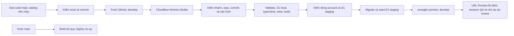

# P01 — GitHub → Workers Builds → Preview
> P01 READY FOR REVIEW cho Preview. Đích account4ca521c6746d874c049fd829121ab59e; Worker/D1 staging đúng account. GitHub→Builds→Preview,45 cloud checks và auto-update PASS. Main live no-op đã có log PASS một lần; Failed retries được giữ riêng. Production chưa triển khai.

Ngày 03/11/2026. Chủ dự án đã xác nhận repo `ducbang02/FreeResources` và account `4ca521c6746d874c049fd829121ab59e` (Nguyenducbang.uit@gmail.com's Account). OAuth dự án và whoami đã khớp account. Build `7de0b863` tại `508a96c` PASS; [Preview](https://develop-digital-resource-hub-staging.nguyenducbang-uit.workers.dev) và bindings được API đọc lại; [45 browser checks](../qa/p01/cloud/results.json) PASS. Production chưa được phép.

## Luồng làm việc hiện tại, đọc từ trái sang phải



1. **Máy local** là nơi sửa code và `data/catalog.json`; chạy kiểm tra trước commit. Local D1 không phải D1 cloud.
2. **GitHub** lưu source chính thức. Push `develop` kích hoạt CI tự động; không cần deploy từ máy cá nhân.
3. **Build command** `npm run ci:build` kiểm nhánh, commit phải đúng HEAD develop từ repo đã duyệt, URL origin đúng GitHub owner/repo (credentials checkout không được log), source sạch và target đúng account. Sau đó validate catalog, migrate/seed D1 local, typecheck, tests, build Astro với config staging và kiểm artifact.
4. **Preview command** `npm run ci:preview:deploy` kiểm proof của build, danh tính account và UUID/name D1; chỉ sau đó migrate/seed **D1 staging** và chạy `wrangler preview`. Không chạy migration production.
5. **Website Preview** dùng URL ổn định phía trên. Deployment ID đổi theo từng lần CI thành công; DB staging hiện được dùng chung cho develop, không tạo DB mới theo mỗi commit. Build lỗi ở gate sẽ không cập nhật Preview. Nếu lỗi sau migration thì dữ liệu staging có thể đã được cập nhật; không coi database và code là một giao dịch chung.
6. **Nhánh main** hiện bị khóa phát hành bằng cả build dispatcher và deploy command no-op. Nhãn “Production” trong Dashboard chỉ là ngữ cảnh của Worker cha, không có nghĩa website production đã được phát hành. Production thật chỉ được thiết lập theo một lệnh duyệt riêng; P01 không có production Worker/database/domain.

Đọc tiến trình: Worker → Deployments → dòng đúng commit/nhánh → Build. Queued là chờ Cloudflare cấp môi trường; xanh build/deploy cần được đối chiếu tiếp bằng Preview URL và bindings, không thay thế QA. Cảnh báo root Wrangler name là do local/staging tách config; pipeline Preview đã chạy với artifact staging khớp tên. Không sửa config local chỉ để ẩn banner.

Khi thấy hai dòng **main** và **develop**, đó là hai lần chạy do hai sự kiện push vào hai nhánh. Trong lần kiểm P01 này, develop phải tạo deployment Preview mới; main phải kết thúc sau thông điệp bỏ qua, không tạo active deployment. Cả hai vẫn dùng cùng một Workers Builds integration.

Khi **người dùng mở website**, luồng khác với luồng build: trình duyệt gọi URL Preview → Worker chạy Astro và đọc D1 staging → trả HTML/dữ liệu cho trình duyệt. Tìm kiếm overlay gọi `/api/search`; Enter mở trang Explore có dữ liệu SSR. GitHub không trực tiếp phục vụ HTML hoặc truy vấn database.

| Thành phần | Vai trò trong P01 |
| --- | --- |
| Local | Máy phát triển: sửa source, chạy tests và D1 giả lập |
| GitHub | Lưu source/commit/nhánh, phát sự kiện push cho Cloudflare |
| Workers Builds | Máy CI của Cloudflare: cài dependency, kiểm và build source, chạy đúng command theo nhánh |
| Worker Preview | Chạy ứng dụng bản thử nghiệm để người dùng mở bằng trình duyệt |
| D1 staging | Database riêng cho bản thử nghiệm; giữ catalog, taxonomy, provenance và FTS |
| main hiện tại | Nhánh source có khóa phát hành bằng commands no-op; tên main không tự mang nghĩa website đã live production |

## Một pipeline, một staging target

Chọn Workers Builds official, không thêm GitHub Actions deployment song song. Nghiên cứu và phiên bản tại [stack audit](PHASE01_STACK_AUDIT.md). Dùng Worker tên kết thúc `-staging`, D1 staging riêng và branch `develop`; không tạo Worker/database production, route/domain, DNS, KV, R2, Images, auth hoặc paid service.

Preview URL là public nếu không cấu hình access control. P01 chỉ có catalog công khai và ảnh/font có quyền phân phối; noindex không phải bảo mật. Không đưa dữ liệu riêng tư lên Preview. Nếu cần dữ liệu nhạy cảm, dừng và thiết kế access control trước.

Config `previews.d1_databases` phải khai báo rõ và trỏ đúng D1 staging; không suy isolation từ URL. P01 chia sẻ **một D1 staging cho Preview develop**, không phải một DB mới cho từng commit/branch. Version URL không tương đương Worker Preview.

## File và guard đã chuẩn bị

| File | Trách nhiệm |
| --- | --- |
| `deploy/staging-target.json.example` | Target chưa duyệt; `approved:false`, account/repository/database ID trống |
| `deploy/wrangler.staging.json.example` | Config riêng cho staging, top-level/Preview cùng D1, parent workers.dev disabled |
| `scripts/preview.mjs` | Plan/build/deploy với kiểm target, source và artifact, branch/repo/commit, D1 identity |
| `scripts/no-production.mjs` | Không mutation; chỉ báo production bị chặn và exit0 |
| `tests/deploy.test.mjs` | Chín nhóm guard kiểm sai target/branch/binding/account, fork/host giả, checkout URL có credentials, resource ngoài scope và no-op production |

Đã có `deploy/staging-target.json` và `deploy/wrangler.staging.json` sau xác nhận: account `4ca521c6746d874c049fd829121ab59e`, Worker đích `digital-resource-hub-staging`, D1 mới cùng tên với ID `e28f4099-92cf-40bc-ab8c-c47138b4469d`, repo `ducbang02/FreeResources`. Worker ID đã đọc lại là `0540bcf9fa6448d6843935471fe0265c`; có 1 version khởi tạo chưa deploy, không bindings, workers.dev tắt (xem [chẩn đoán Connect](PHASE01_CLOUD_CONNECTION.md#chẩn-đoán-nút-connect-bị-khóa)). Target `approved:true` sau xác minh; guard chặn cứng account/repo khác. Account ID và database ID không phải credential; không đặt token trong JSON. Bất kỳ field target lạ, placeholder, Worker/DB không phải staging, binding không khớp hoặc resource ngoài scope đều bị chặn. Template chưa duyệt vẫn giữ làm ví dụ tái sử dụng, không được coi là target thật.

`plan` chỉ in các thao tác dự kiến từ target hợp lệ; không gọi Cloudflare. `build` chạy validation, D1 migrations/seed **local**, typecheck, tests rồi Astro build với config staging được chỉ định. Khi các bước thành công, ghi proof trong `.cache/` gắn với commit, target, config/artifact, lockfile, seed và migrations. `deploy` chỉ dùng proof còn khớp và artifact đã kiểm; sau đó mới preflight remote rồi migrate/seed D1 staging và chạy `wrangler preview`.

Script không gọi `wrangler deploy`, `versions upload`, secret mutation hoặc tạo resource. `--ignore-base-config` ngăn dashboard Preview base config bổ sung binding chưa review. Generated artifact do adapter sinh, không chỉnh tay.

## Tham chiếu quy trình chuẩn bị target

1. Xác minh GitHub owner/repo và visibility thực tế, account Cloudflare đúng, quyền và Free plan. Chỉ cấp GitHub App quyền lên repo được xác nhận. Không cấp toàn bộ repo khi không cần. Không tự nâng gói.
2. Dùng repo/remote đã được chỉ định; không tự thay visibility. Push checkpoint có tên rõ, không force push. Có branch `main` cho trạng thái khóa release và `develop` cho staging; không để `develop` làm production branch của Workers Builds theo default tự động.
3. Tạo Worker staging và D1 staging mới trong account xác nhận, **không tạo production Worker**. Đọc lại ID/name/account sau tạo, ghi vào `deploy/staging-target.json` rồi đặt `approved:true` sau kiểm. Điền cùng các giá trị vào `deploy/wrangler.staging.json`; không dùng DB từ dự án khác hoặc production.
4. Astro adapter cần chọn `configPath:'deploy/wrangler.staging.json'` chỉ khi `P01_STAGING_BUILD=1`; local tiếp tục dùng `wrangler.jsonc`. Root tích hợp lựa chọn này trong `astro.config.mjs`. Session và Images passthrough giữ như hiện tại.
5. Các package scripts đã có trong `package.json`:

```json
{
  "ci:build": "node scripts/build-worker.mjs",
  "ci:preview:plan": "node scripts/preview.mjs plan",
  "ci:preview:build": "node scripts/preview.mjs build",
  "ci:preview:deploy": "node scripts/preview.mjs deploy",
  "ci:production": "node scripts/no-production.mjs"
}
```

`build` được gọi qua npm script để có `npm_execpath` đúng trên Windows/Linux. Không shell-build command từ JSON hoặc chạy lệnh tùy ý do metadata cung cấp.

## Thiết lập dashboard trước push kết nối đầu

Ở Worker **staging đã xác nhận**, kiểm Settings → Builds và Branch control. Không giữ nguyên default được suy từ default branch của GitHub.

| Setting | Giá trị cần đọc lại |
| --- | --- |
| Connected repository | Repo ducbang02/FreeResources, hiện public, cùng origin |
| Production branch | `main`, không phải `develop` |
| Build command | `npm run ci:build` |
| Deploy command | `npm run ci:production` — không upload/migrate/deploy |
| Enable Preview Builds | Bật non-production builds; repo guard chỉ cho `develop` triển khai |
| Preview command | `npm run ci:preview:deploy` |
| Runtime | Node 24.18.0 từ `.node-version`, npm 12.2.0 từ `packageManager`; NODE_VERSION trong UI là tùy chọn |
| Token scope | Chỉ account/Worker staging và D1 staging theo khả năng giới hạn của Cloudflare; không credential trong Git |

Dashboard branch controls là một phần acceptance, không thay bằng unit test. Chụp/ghi setting thực trước khi kích hoạt lần đầu. Common build dispatcher bỏ qua main với exit0 và không build/upload; nhánh ngoài main/develop bị từ chối. Production deploy command vẫn là no-op. Chỉ `develop` mới có thể vượt guard.

Workers Builds cung cấp `WORKERS_CI=1`, `WORKERS_CI_BRANCH` và `WORKERS_CI_COMMIT_SHA`. Guard so HEAD với SHA này, kiểm origin đúng repo, yêu cầu tracked tree sạch và **đối chiếu HEAD với `refs/heads/develop` đọc từ đúng GitHub repo đã duyệt**. Nhờ vậy tên branch `develop` từ fork/PR không đủ để deploy. Cloud build cần đọc được ref repo được duyệt khi `git ls-remote` chạy; nếu quyền đọc không có, giữ trạng thái BLOCKED, không gỡ guard để cho qua.

Không chạy fork/PR không tin cậy với quyền cloud. Nếu dashboard không thể chứng minh branch control hoặc phạm vi integration phù hợp, dừng trước kết nối; đánh giá fallback GitHub Actions staging-only riêng, tắt Workers Builds trước khi thay. Không tự bật pipeline thứ hai.

## Thứ tự chạy và nghiệm thu cloud

1. Local migration/seed/typecheck/unit/integration/browser PASS, code và config commit/push lên `develop` sau khi target/repo được duyệt.
2. Workers Builds chạy guarded build; kiểm generated `dist/server/wrangler.json` có đúng Worker/account/D1 và không tự phát sinh KV/Images/session/service bindings.
3. Guard đọc danh tính Cloudflare và `wrangler d1 info` để đối chiếu UUID/name của D1 staging. Những lệnh này chỉ đọc; nếu không trùng thì dừng.
4. Chỉ khi proof/identity đều khớp mới chạy các lệnh dưới bằng Wrangler local đã pin:

```text
wrangler d1 migrations apply DB --remote --config deploy/wrangler.staging.json
wrangler d1 execute DB --remote --config deploy/wrangler.staging.json --file data/seed.sql
wrangler preview --config dist/server/wrangler.json --name develop --worker-name <approved-staging-worker> --ignore-base-config
```

`--name` là tên Preview; `--worker-name` là Worker cha, không được đảo hai cờ. Các lệnh migration/seed đã chạy trên D1 đúng account và PASS. Lệnh Preview vẫn là bước pipeline chưa chạy; không copy placeholder để thực thi. Seed SQL là metadata công khai, không installer/ISO/source code từ repo được phát hiện.

5. Lấy URL thật từ build log, browser QA1440/768/390: Home/Explore/Detail, truy vấn D1, search dấu/không dấu, filter/pagination, loading/empty/error/retry, keyboard, font/ảnh/overflow/console. Kiểm robots/noindex và runtime logs; API data từ D1 staging thật. Ghi commit/build/Preview ID/DB ID và các PASS/FAIL/SKIP, không gộp local PASS thành cloud PASS.
6. Push checkpoint tiếp theo lên develop để chứng minh cập nhật tự động qua GitHub; không dựa vào deploy thủ công từ máy. Xác minh main không cập nhật active deployment bằng setting/log trước các thử nghiệm có mutation.

## Validation và trạng thái hiện tại

**PASS local:** 22 tests, gồm13 catalog và9 guard; production no-op exit0, từ chối account sai, fork/host giả và template chưa duyệt. Typecheck/build/dry-run và45 dev +45 built Worker browser checks PASS;40PNG. Phiên bản toolchain không đổi.

**PASS cloud target:** OAuth dự án thành công, whoami đúng account; Worker/D1 mới đã tạo, đọc lại và target chỉ approved sau đối chiếu ID. D1 migrate/seed/readback PASS: 13 tài nguyên, 17 nguồn, FK 0, FTS LocalSend. Hai tài nguyên tạo nhầm đã xóa theo yêu cầu, GET trả 404. Proof tại [cloud resources](../qa/p01/cloud-resources.json), [D1](../qa/p01/cloud-d1.json), [cleanup](../qa/p01/ctcm-cleanup.json).

**PASS GitHub/Preview:** repo public, sunny251010 có quyền push nhưng không admin. Commit508a96c được Builds triển khai thành Preview develop; annotations repository/tag và D1 bindings khớp, Worker cha deployed_on:null. Cloud browser45 checks PASS/20PNG. Checkpoint31d3053 tự tạo deployment7a79bea8-f3e9-473d-9567-2e4d38ae1f00 mới, cùng URL/DB;5 smoke checks sau cập nhật PASS. [Bằng chứng](../qa/p01/cloud-auto-update.json).

**Giới hạn đọc log:** OAuth dự án không có quyền Builds API; đúng endpoint list builds trả403/code12004. Chủ dự án hỗ trợ ảnh Dashboard/log; browser điều khiển Dashboard không khởi tạo được. Playwright local vẫn truy cập và kiểm Preview thật. Không yêu cầu gửi token.

**PASS main live no-op:** chủ dự án cung cấp log kết thúc16:01:15.010UTC và dòng main Ready43s; hai commands bỏ qua build/deploy có chủ ý. [Log](../qa/p01/build-main-noop-success.txt), [main proof](../qa/p01/main-protection.json). Dashboard vẫn No active deployment. UUID/SHA riêng của lần xanh chưa hiện trong log/ảnh; không suy các dòng Failed thành PASS. Lần aa369850/31d3053 timeout trước clone được giữ là FAIL lịch sử; dòng Failed mới hơn chưa đủ log để phân tích. **SKIP:** physical mobile/software keyboard/AT/Safari/Firefox. Audit không đổi settings, không push hoặc retry thêm.

## Nguồn chính thức đã đối chiếu

- [Workers Builds branch controls](https://developers.cloudflare.com/workers/ci-cd/builds/build-branches/) — production/default branch và Preview command.
- [Build configuration/environment variables](https://developers.cloudflare.com/workers/ci-cd/builds/configuration/) — biến CI do Builds cấp; được đối chiếu qua Context7 official Workers docs.
- [Build image](https://developers.cloudflare.com/workers/ci-cd/builds/build-image/) — pin runtime của build.
- [Preview configuration](https://developers.cloudflare.com/workers/previews/configuration/), [resource isolation](https://developers.cloudflare.com/workers/previews/resources/) — settings và storage phải khai báo riêng.
- [Wrangler Preview command](https://developers.cloudflare.com/workers/wrangler/commands/workers/#preview), [D1 commands](https://developers.cloudflare.com/d1/wrangler-commands/) — cú pháp hiện hành; help/schema local là baseline đã pin.

Production release cần lệnh duyệt riêng, cấu hình Worker/DB/domain riêng, migrations/test/release/rollback tương ứng. Runbook P01 này không có production deployment path.

## Xác thực khi tiếp tục

Phiên global Ctcm được giữ nguyên. Lệnh Wrangler dùng OAuth dự án phải đặt XDG_CONFIG_HOME trỏ đường dẫn tuyệt đối tới .cache/free-resources-auth và XDG_CACHE_HOME tới .cache/free-resources-auth-cache theo từng lệnh; không đọc/in file auth hoặc token. Không đổi HOME/profile global. Account đích phải tiếp tục khớp ID đã duyệt.

Dashboard đã nối và setting được quan sát qua ảnh chủ dự án. Main production command tiếp tục no-op; non-production builds bật nhưng guard chỉ cho develop qua. Không nối sang account khác, không tạo tài nguyên production hoặc pipeline deployment song song.
